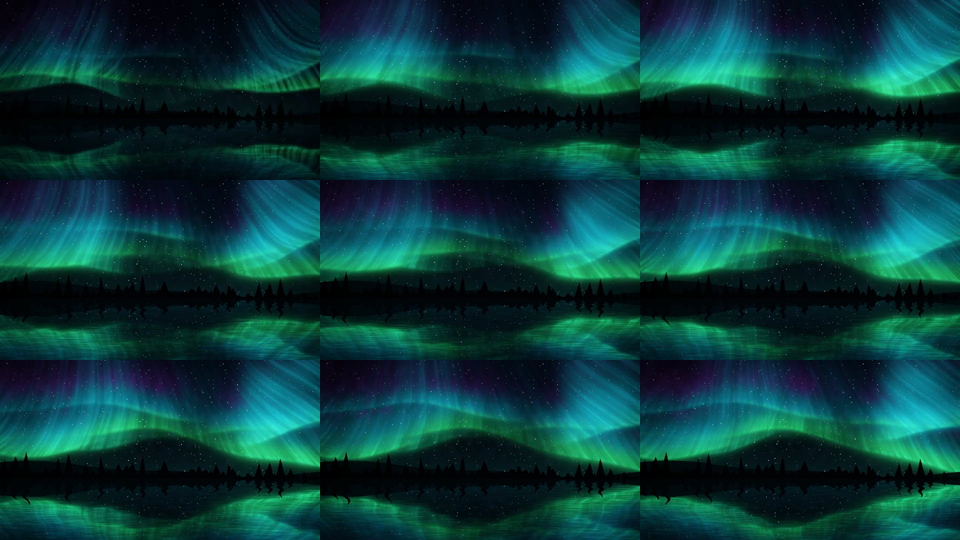
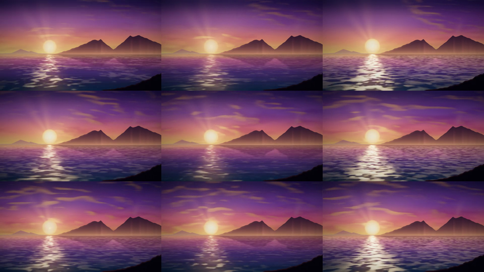
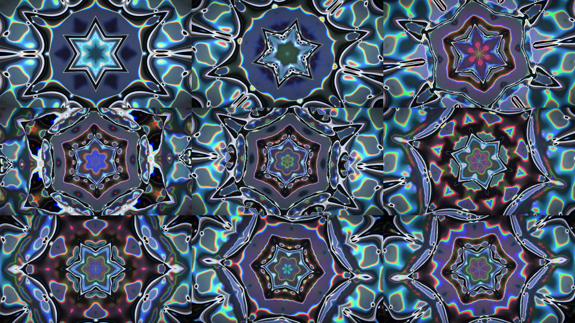
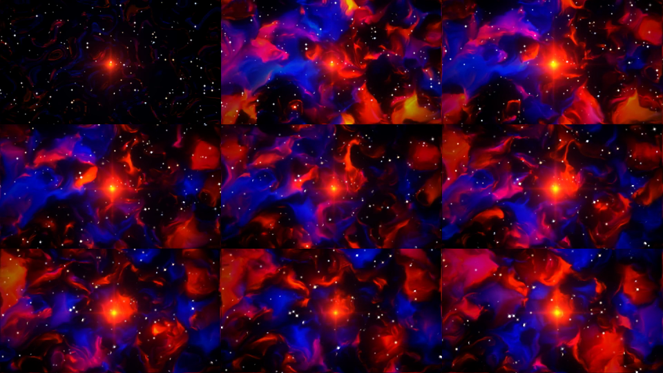
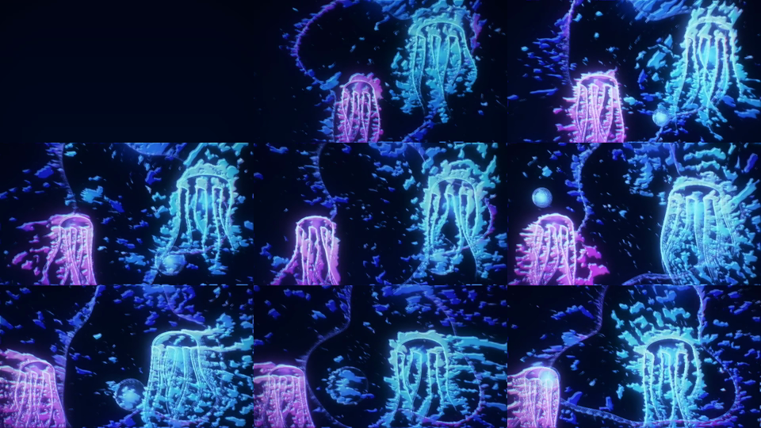
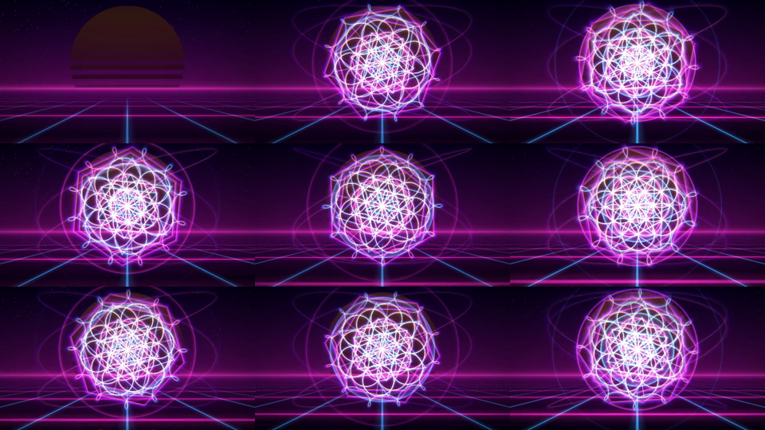

# projectM Presets by M0Rf30

A curated collection of original MilkDrop 2 presets for [projectM](https://github.com/projectM-visualizer/projectm) (libprojectM ≥ 4.1) and MilkDrop 2/3.
They use per-frame equations, custom waves and shapes, and warp and comp pixel shaders.

| | |
|---|---|
| **Aurora Cathedral**: northern-lights curtains over a mirrored lake. Bass makes the curtains surge; hi-hats make the stars twinkle. |  |
| **Tramonto sul Golfo**: sunset over the Gulf of Naples with Vesuvius. The sun swells on the kick and the sea glitter follows the treble. |  |
| **Liquid Chrome Kaleidoscope**: a 12-mirror kaleidoscope of molten chrome with rainbow edges. It pulses outward and rotates on each kick. |  |
| **Nebula Forge**: Hubble-like gas clouds around a white-hot core. The core flares and sends out a shock ring on each kick. |  |
| **Bioluminescent Abyss**: glowing jellyfish, cell-like patterns and plankton in deep water. |  |
| **Neon Sacred Geometry**: a flower-of-life mandala over a synthwave grid. It snaps 30° on each beat. |  |

## Install

Arch Linux (AUR): `projectm-presets-m0rf30-git`

Manual install:

```sh
sudo make install            # → /usr/share/projectM/presets/m0rf30
```

You can also copy `presets/*.milk` into your own projectM or MilkDrop presets folder.

## Development tools

`tools/` contains a headless renderer for previewing and checking presets. It needs `libprojectm`, EGL and `ffmpeg`.

```sh
make                                   # build tools/render
make validate                          # check all warp/comp shaders really compile
FRAMES=600 tools/preview.sh presets/X.milk   # 10 s mp4 + 3×3 contact sheet in renders/
```

When an HLSL shader fails to compile, projectM gives no error and quietly uses its default shader instead. `validate.py` detects this by adding a test colour to each shader and checking that it appears in the rendered output.
The renderer runs in real time because projectM 4.1 times its animation by the wall clock.

## License

MIT
