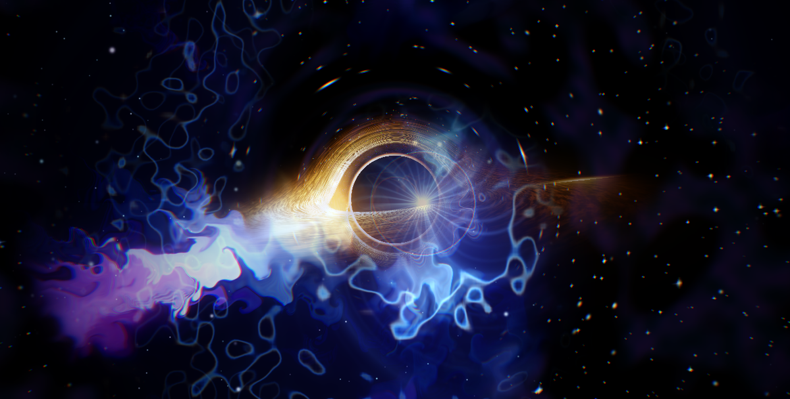
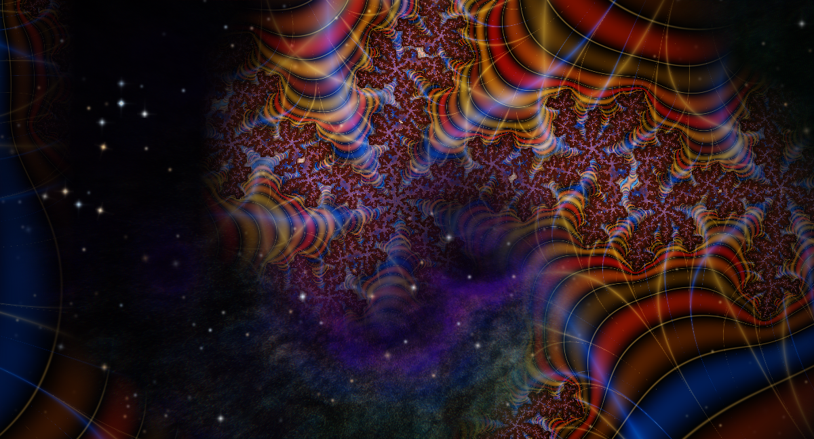
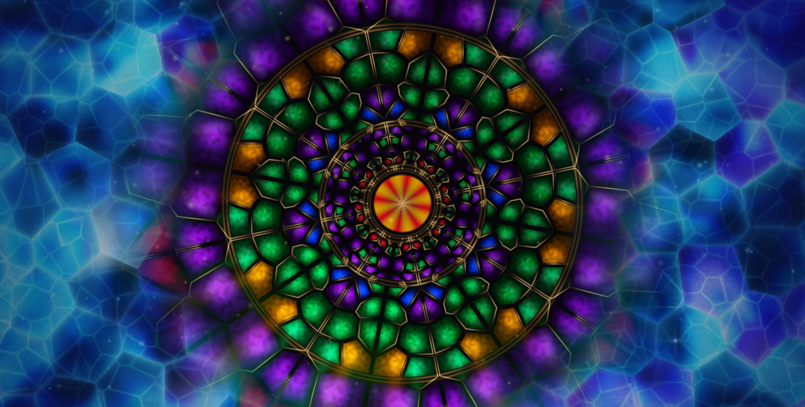
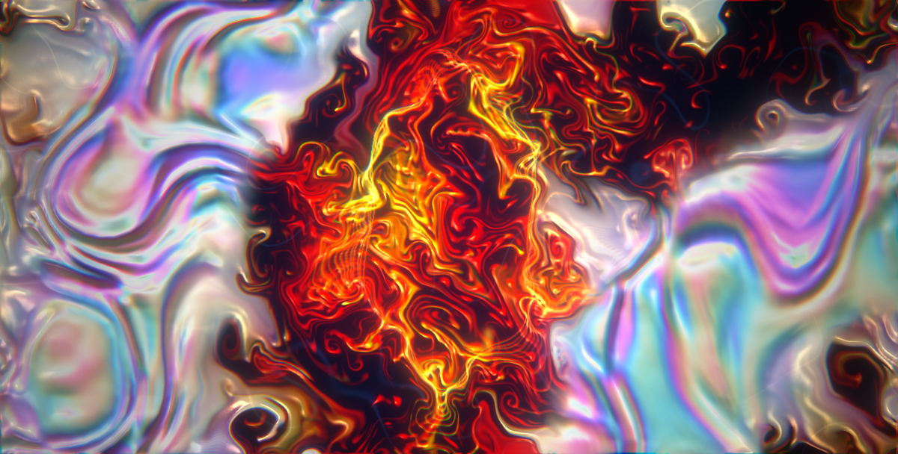
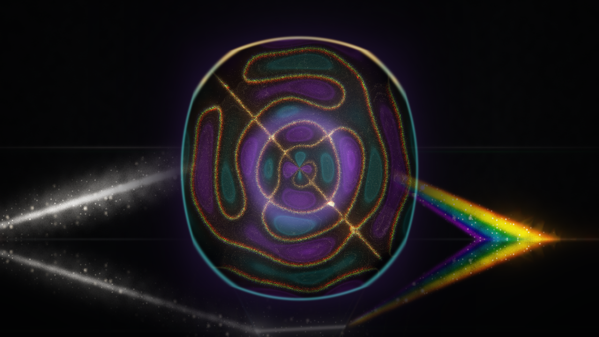

# projectM Presets by M0Rf30

A curated collection of original MilkDrop 2 presets for [projectM](https://github.com/projectM-visualizer/projectm) (libprojectM ≥ 4.1) and MilkDrop 2/3.
They use per-frame equations, custom waves and shapes, and warp and comp pixel shaders.

| | |
|---|---|
| **Aurora Cathedral**: northern-lights curtains over a mirrored lake. Bass makes the curtains surge; hi-hats make the stars twinkle. |  |
| **Tramonto sul Golfo**: sunset over the Gulf of Naples with Vesuvius. The sun swells on the kick and the sea glitter follows the treble. |  |
| **Liquid Chrome Kaleidoscope**: a 12-mirror kaleidoscope of molten chrome with rainbow edges. It pulses outward and rotates on each kick. |  |
| **Nebula Forge**: Hubble-like gas clouds around a white-hot core. The core flares and sends out a shock ring on each kick. |  |
| **Bioluminescent Abyss**: glowing jellyfish, cell-like patterns and plankton in deep water. |  |
| **Neon Sacred Geometry**: a flower-of-life mandala over a synthwave grid. It snaps 30° on each beat. |  |

## Double presets (`.milk2`)

`milk2/` holds MilkDrop 3 double presets. Each file is two complete presets drawn at the same time and stitched together by a frozen MilkDrop 3 blend pattern, so the picture is half one scene and half another, joined by the pattern's seam. They need a MilkDrop 3 compatible player such as [lactea](https://github.com/M0Rf30/lactea) (`--compat milkdrop3`, or `auto`, which detects them). Plain projectM does not load `.milk2`. They also use MilkDrop 3's `get_fft()` spectrum lookup in their shaders.

| | |
|---|---|
| **Event Horizon** (`snail`): a raymarched Schwarzschild black hole with a lensed accretion disc, Doppler beaming and a photon ring, against a cold supernova nebula. Each kick drops a hotspot into the disc. |  |
| **Fractal Sanctum** (`snail`): a morphing Julia set with orbit-trap stained-glass colouring, against a Kali-set nebula flythrough. |  |
| **Crystal Cathedral** (`cercle`): a stained-glass rose window whose cells pulse with the spectrum, in the middle of an ice-crystal cavern. |  |
| **Liquid Silk** (`wave`): iridescent oil-slick silk, torn open by gold and crimson ink advected along curl noise. |  |
| **Hyperspace** (`cercle`): a warp-drive starfield with a wandering, kick-whipped camera, inside an ember wormhole whose rings follow the spectrum. |  |
| **Cymatic Prism** (`square`): a Chladni plate where glowing sand settles on the nodal lines, next to a prism splitting a beam into a spectrum-driven rainbow. |  |

The sources are in `milk2/src/<name>/`: `a.milk` and `b.milk` (two ordinary presets, each also runnable alone) and `milk2.json` (pattern, progress, direction and the five random values). `make milk2` rebuilds all the `.milk2` files from them with `tools/mkmilk2.py`.

## Install

Arch Linux (AUR): `projectm-presets-m0rf30-git`

Manual install:

```sh
sudo make install            # → /usr/share/projectM/presets/m0rf30
```

You can also copy `presets/*.milk` into your own projectM or MilkDrop presets folder, and `milk2/*.milk2` into a MilkDrop 3 / lactea one. `make install` installs both; projectM ignores `.milk2`.

## Development tools

`tools/` contains a headless renderer for previewing and checking presets. It needs `libprojectm`, EGL and `ffmpeg`.

```sh
make                                   # build tools/render
make validate                          # check all warp/comp shaders really compile
FRAMES=600 tools/preview.sh presets/X.milk   # 10 s mp4 + 3×3 contact sheet in renders/
```

When an HLSL shader fails to compile, projectM gives no error and quietly uses its default shader instead. `validate.py` detects this by adding a test colour to each shader and checking that it appears in the rendered output.
The renderer runs in real time because projectM 4.1 times its animation by the wall clock.

`tools/shot.sh` renders a `.milk` or `.milk2` in lactea (MilkDrop 3 mode, deterministic 60 fps clock, a synthetic 128 bpm track from `tools/synth.py`) and saves screenshots at the frames you give it. It prints lactea's `WARN` line when a shader fails to compile, and runs one lactea at a time (the lactea window must be visible, or the compositor stalls it):

```sh
tools/shot.sh milk2/src/hyperspace/a.milk /tmp/shots 240 600 1200
```

`tools/render` can also play real audio and mimic a particular frontend. All options are environment variables:

| Variable | Meaning |
|---|---|
| `AUDIO=file.f32` | raw f32le stereo 44.1 kHz instead of the synthetic 128 bpm track (`ffmpeg -i song.mp3 -f f32le -ac 2 -ar 44100 file.f32`) |
| `AUDIO_START=<s>` | start offset into that file |
| `FPS=<n>` | pacing, `projectm_set_fps` and samples per frame (default 60; Aulos uses 30) |
| `MESH=default` | keep projectM's default mesh instead of 96×72 |
| `FEED=full\|aulos_old\|last576` | how much of each frame's audio is handed to projectM |
| `GAIN=<x>` | scale the audio, to test loudness |

`tools/probe.milk` is a preset whose comp shader paints projectM's per-frame `bass`, `bass_att`, `mid`, `mid_att`, `treb`, `treb_att`, `vol`, `fps` into eight pixel strips (integer part in red, fraction in green), since the API cannot read them back.
`tools/beatbench.py song.mp3 --fps 30 presets/*.milk` renders presets against a real song and reports how much brighter and how much faster-changing the picture is right after the song's onsets, against the same measurement at random times (`--probe` prints the band ranges instead).

## Beat reactivity

projectM 4 computes `bass`, `mid` and `treb` as the summed FFT energy of the lowest three sixths of the spectrum (roughly 0–3.7 kHz, 3.7–7.3 kHz and 7.3–11 kHz, so "bass" is really low-mids and drums), divided by a running average over about 4 s. They hover around 1 and reach 2–3 on a hit. `bass_att` and friends are the same value after a fast smoothing, one frame of which already follows 80 % of a jump at 30 fps (`0.2^(30/fps)`).

Old presets often test `bass - k*bass_att`. That is sharp at 60 fps on a clean synthetic kick but almost never exceeds its threshold at 30 fps on real music, so these presets compare `bass` with its own running mean and spread instead:

```
bm  = bm + (bass-bm)*(1-exp(-dt/0.8));              // running mean, ~0.8 s
bd  = bd + (abs(bass-bm)-bd)*(1-exp(-dt/2.5));       // running mean absolute deviation, ~2.5 s
hit = clamp(((bass-bm)/max(bd,0.1) - 0.8)/1.5, 0, 1) // 0 below 0.8 deviations, 1 above 2.3
```

`dt` comes from the real frame time (`time`), and pulse decays are written as `pow(k, 60*dt)`, so the response is the same at 20, 30 or 60 fps and at any loudness.

## License

MIT
